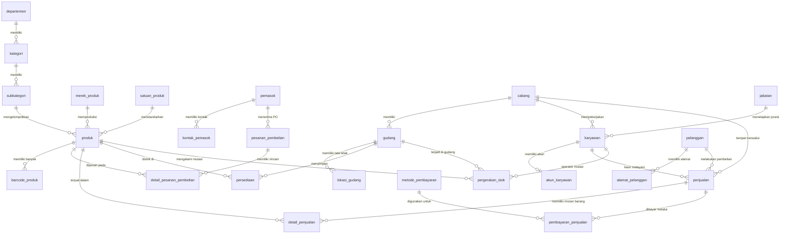

# SISTEM MANAJEMEN SUPERMARKET

Aplikasi web manajemen supermarket berbasis relasional database MySQL dan PHP Native (PHP 8+) yang dirancang khusus sebagai media pembelajaran basis data untuk siswa SMK Rekayasa Perangkat Lunak (RPL).

Aplikasi ini mendemonstrasikan implementasi nyata dari konsep basis data relasional: **Primary Key**, **Foreign Key**, **Constraint Integrity**, **Normalisasi Database**, serta operasi **CRUD (Create, Read, Update, Delete)** yang berfungsi penuh pada **tepat 25 tabel database**.

---

## DAFTAR ISI

1. [Gambaran Umum & Fitur Unggulan](#gambaran-umum--fitur-unggulan)
2. [Teknologi yang Digunakan](#teknologi-yang-digunakan)
3. [Daftar 25 Tabel Relasional](#daftar-25-tabel-relasional)
4. [Diagram Relasi Antartabel (ERD)](#diagram-relasi-antartabel-erd)
5. [Panduan Instalasi & Menjalankan di Laragon](#panduan-instalasi--menjalankan-di-laragon)
6. [Kredensial Akun Login](#kredensial-akun-login)
7. [Checklist Pengujian CRUD (25 Tabel)](#checklist-pengujian-crud-25-tabel)
8. [Pengujian Otomatis (Automated Test Suite)](#pengujian-otomatis-automated-test-suite)
9. [Struktur Folder Project](#struktur-folder-project)

---

## GAMBARAN UMUM & FITUR UNGGULAN

- **100% PHP Native (PHP 8+) & Bersih**: Dibangun tanpa framework (No Laravel, No React, No Vue) agar alur kerja kode mudah dipahami dan dipelajari baris demi baris oleh siswa SMK RPL.
- **Tepat 25 Tabel Saling Berelasi**: Seluruh tabel menggunakan penamaan Bahasa Indonesia dengan format `snake_case` dan engine MySQL `InnoDB`.
- **CRUD Lengkap 25 Tabel**: Setiap tabel memiliki antarmuka Create, Read (dengan pencarian, filter, dan pagination), Update, dan Delete yang aman.
- **Dropdown Berelasi Cerdas**: Pengguna tidak pernah diminta menginput Foreign Key ID secara mentah; seluruh input berelasi menggunakan dropdown dengan data deskriptif yang diambil langsung dari tabel referensi.
- **Integritas Foreign Key Terproteksi**: Penghapusan data induk yang masih dijadikan referensi pada tabel anak dicegah dengan penanganan error database yang jelas dan ramah pengguna.
- **Kasir Cepat (Point of Sale / POS)**:
  - Pencarian produk instan dan pemindaian barcode.
  - Perhitungan subtotal, diskon, pajak, dan kembalian otomatis.
  - Database Transaction (ACID) untuk memastikan faktur, rincian produk, dan pembayaran tercatat secara atomik.
  - Cetak struk/faktur pembayaran siap cetak (`window.print()`).
- **Otomatisasi Inventaris & Kartu Stok**:
  - Mutasi stok barang otomatis berkurang saat penjualan dan bertambah saat penerimaan pesanan pembelian (PO).
  - Peringatan stok minimum di Dashboard.
  - Pencegahan stok negatif (`stock underflow`).
  - Buku besar mutasi stok (`pergerakan_stok`) mencatat stok sebelum, stok sesudah, kuantitas, jenis mutasi, dan nomor referensi.
- **Keamanan Berlapis**:
  - PDO Prepared Statements untuk pencegahan SQL Injection.
  - Validasi CSRF Token pada seluruh formulir transaksi dan tombol hapus data.
  - Password hashing menggunakan algoritma aman `password_hash()` (Bcrypt).
  - Sanitasi output HTML (`htmlspecialchars`) untuk proteksi XSS.
  - Otentikasi sesi (`session_start()`, `cek_login()`, dan timeout).

---

## TEKNOLOGI YANG DIGUNAKAN

| Komponen | Spesifikasi / Pustaka |
| :--- | :--- |
| **Bahasa Pemrograman Backend** | PHP 8.0+ (PHP Native, PDO Extension) |
| **Basis Data** | MySQL 8.0+ (Engine: InnoDB, Charset: utf8mb4) |
| **Antarmuka (Frontend)** | HTML5, CSS3, Modern JavaScript (Vanilla) |
| **Framework CSS** | Bootstrap 5.3.3 |
| **Ikonografi** | Bootstrap Icons 1.11.3 |
| **Web Server Lokal** | Apache 2.4 (Laragon / XAMPP) |
| **Database Manager** | phpMyAdmin / MySQL CLI |

---

## DAFTAR 25 TABEL RELASIONAL

Database: `db_supermarket`

### A. Data Utama (8 Tabel)
1. `cabang` – Menyimpan daftar kantor cabang / gerai supermarket.
2. `departemen` – Pengelompokan divisi operasional (misal: Makanan & Minuman, Perawatan Tubuh).
3. `kategori` – Kategori besar produk yang terhubung ke departemen.
4. `subkategori` – Sub-kategori turunan dari kategori utama.
5. `merek_produk` – Merek atau brand dari barang dagangan.
6. `satuan_produk` – Satuan unit barang (Pcs, Box, Kg, Liter, Pack).
7. `produk` – Katalog produk dengan referensi subkategori, merek, satuan, harga beli, dan harga jual.
8. `barcode_produk` – Mendukung multi-barcode (EAN-13, UPC-A, Code-128) per item produk.

### B. Pengadaan Barang (4 Tabel)
9. `pemasok` – Data rekanan vendor / supplier penyedia barang.
10. `kontak_pemasok` – Daftar PIC, nomor telepon, dan email narahubung pemasok.
11. `pesanan_pembelian` – Header dokumen Purchase Order (PO) kepada pemasok.
12. `detail_pesanan_pembelian` – Rincian item produk, kuantitas order, dan harga beli per PO.

### C. Data Pelanggan (2 Tabel)
13. `pelanggan` – Data profil member / pelanggan supermarket.
14. `alamat_pelanggan` – Menyimpan multi-alamat (rumah, kantor) per pelanggan.

### D. Data Karyawan (3 Tabel)
15. `jabatan` – Struktur posisi kerja (Kasir, Supervisor, Manajer Toko, Staf Gudang).
16. `karyawan` – Profil identitas staf, nomor kontak, gaji pokok, dan penempatan cabang.
17. `akun_karyawan` – Akun login sistem dengan username, password hash Bcrypt, dan hak akses (role).

### E. Manajemen Inventaris (4 Tabel)
18. `gudang` – Data gudang penyimpanan barang per cabang.
19. `lokasi_gudang` – Kode rak, lorong, dan tier penyimpanan di dalam gudang.
20. `persediaan` – Stok fisik produk per gudang dilengkapi batas stok minimum.
21. `pergerakan_stok` – Log audit histori mutasi barang masuk, keluar, retur, dan penyesuaian (stock opname).

### F. Penjualan & Kasir (4 Tabel)
22. `penjualan` – Header faktur transaksi kasir, diskon faktur, pajak, dan grand total.
23. `detail_penjualan` – Rincian item barang yang terjual, harga saat transaksi, diskon item, dan subtotal.
24. `metode_pembayaran` – Opsi saluran pembayaran (Tunai, Debit BCA/Mandiri, QRIS, GoPay, OVO).
25. `pembayaran_penjualan` – Log rekonsiliasi pembayaran, nomor transaksi, nominal bayar, dan uang kembalian.

---

## DIAGRAM RELASI ANTARTABEL (ERD)



---

## PANDUAN INSTALASI & MENJALANKAN DI LARAGON

### 1. Prasyarat Sistem
- **Laragon Full** (termasuk Apache, PHP 8+, MySQL 8+, dan phpMyAdmin).
- Peramban web modern (Google Chrome, Microsoft Edge, Mozilla Firefox).

### 2. Penempatan Berkas Project
Pastikan folder project diletakkan di direktori web root Laragon:
```
C:\laragon\www\supermarket
```
Aplikasi juga dapat diakses melalui alias direktori:
```
http://localhost/supermarket-management/
```
atau
```
http://localhost/supermarket/
```

### 3. Menjalankan Layanan Laragon
1. Buka aplikasi **Laragon**.
2. Klik tombol **Start All** untuk menyalakan modul Apache dan MySQL.

### 4. Impor Database MySQL
1. Buka browser dan buka phpMyAdmin di: `http://localhost/phpmyadmin/`.
2. Klik tab **Import**.
3. Pilih berkas `database.sql` yang berada di dalam folder project:
   ```
   C:\laragon\www\supermarket\database.sql
   ```
4. Klik **Go** / **Impor**.
5. Database `db_supermarket` beserta seluruh 25 tabel dan data awal (sample data) akan otomatis terpasang.

*Catatan: Anda juga dapat mengimpor langsung lewat Terminal / Command Prompt Laragon:*
```bash
mysql -u root < C:\laragon\www\supermarket\database.sql
```

### 5. Konfigurasi Koneksi Database
Berkas konfigurasi terletak di `config/koneksi.php`:
```php
define('DB_HOST', 'localhost');
define('DB_PORT', '3306');
define('DB_NAME', 'db_supermarket');
define('DB_USER', 'root');
define('DB_PASS', '');
```
Sesuaikan kata sandi jika instalasi MySQL Anda menggunakan password root.

### 6. Akses Aplikasi di Browser
Buka peramban web dan arahkan ke:
```
http://localhost/supermarket-management/
```

---

## KREDENSIAL AKUN LOGIN

Aplikasi dilengkapi dengan 4 akun pengguna siap pakai berdasarkan perannya:

| Role / Peran | Username | Password | Deskripsi Hak Akses |
| :--- | :--- | :--- | :--- |
| **Administrator** | `admin` | `admin123` | Akses penuh ke seluruh 25 tabel master, inventaris, transaksi, dan akun. |
| **Kasir** | `kasir` | `admin123` | Akses langsung ke modul Kasir Cepat (POS), faktur penjualan, dan pelanggan. |
| **Staf Gudang** | `gudang` | `admin123` | Akses modul pengadaan barang (PO), stok persediaan, dan mutasi barang. |
| **Manajer Toko** | `manajer` | `admin123` | Akses laporan rekapitulasi penjualan, monitoring cabang, dan audit stok. |

---

## CHECKLIST PENGUJIAN CRUD (25 TABEL)

Seluruh 25 tabel database berikut telah memiliki implementasi formulir tambah data, daftar data terpaginasi dengan pencarian, pembaruan data, dan penghapusan data berproteksi CSRF:

- [x] **1. Cabang**: Tambah, Cari, Edit info kontak/alamat, Hapus (dengan proteksi FK karyawan/gudang).
- [x] **2. Departemen**: Tambah divisi baru, Edit nama & deskripsi, Hapus berelasi kategori.
- [x] **3. Kategori**: Dropdown departemen, Tambah kategori, Edit, Hapus berelasi subkategori.
- [x] **4. Subkategori**: Dropdown kategori, Tambah subkategori, Edit, Hapus berelasi produk.
- [x] **5. Merek Produk**: Tambah nama brand & negara asal, Edit, Hapus berelasi produk.
- [x] **6. Satuan Produk**: Tambah unit (Pcs, Box, Kg), Edit simbol, Hapus berelasi produk.
- [x] **7. Produk**: Dropdown subkategori, merek, dan satuan; kelola harga beli/jual dan stok minimum.
- [x] **8. Barcode Produk**: Dropdown produk, Tambah kode barcode (EAN-13, QR), status utama.
- [x] **9. Pemasok**: Tambah vendor, alamat, nomor telepon resmi, status aktif/nonaktif.
- [x] **10. Kontak Pemasok**: Dropdown pemasok, Tambah nama PIC, nomor WhatsApp, jabatan PIC.
- [x] **11. Pesanan Pembelian**: Dropdown pemasok & cabang, nomor PO otomatis, status pemesanan.
- [x] **12. Detail Pesanan Pembelian**: Dropdown nomor PO & produk, hitung subtotal & total otomatis.
- [x] **13. Pelanggan**: Registrasi member, nomor telepon, email, poin member, status.
- [x] **14. Alamat Pelanggan**: Dropdown pelanggan, tambah alamat pengiriman, status alamat utama.
- [x] **15. Jabatan**: Tambah posisi kerja, batas gaji pokok minimum & maksimum.
- [x] **16. Karyawan**: Dropdown cabang & jabatan, biodata lengkap, tanggal masuk, status kepegawaian.
- [x] **17. Akun Karyawan**: Dropdown karyawan, hashing password Bcrypt, pemilihan peran sistem.
- [x] **18. Gudang**: Dropdown cabang, tambah data gedung/area gudang penyimpanan.
- [x] **19. Lokasi Gudang**: Dropdown gudang, kelola penamaan kode rak, lorong, dan tingkat bin.
- [x] **20. Persediaan**: Dropdown produk & gudang, monitor kuantitas stok fisik dan batas minimum.
- [x] **21. Pergerakan Stok**: Catat riwayat audit mutasi stok masuk, keluar, retur, atau opname.
- [x] **22. Penjualan**: Nomor faktur transaksi unik, tanggal, kasir bertugas, diskon, dan pajak.
- [x] **23. Detail Penjualan**: Dropdown faktur & produk, kuantitas beli, harga satuan, dan diskon item.
- [x] **24. Metode Pembayaran**: Kelola saluran bayar (Tunai, Debit, Kredit, QRIS, E-Wallet).
- [x] **25. Pembayaran Penjualan**: Dropdown faktur & metode bayar, input nominal bayar, dan hitung kembalian.

---

## PENGUJIAN OTOMATIS (AUTOMATED TEST SUITE)

Aplikasi menyertakan script pengujian otomatis untuk memverifikasi integritas database dan fungsionalitas logika bisnis.

Untuk menjalankan pengujian, jalankan perintah berikut di terminal:
```bash
php tests/test_suite.php
```

Output pengujian mencakup:
1. Verifikasi kelengkapan tepat 25 tabel relasional di MySQL.
2. Pengujian otentikasi login akun dan hashing password Bcrypt.
3. Pengujian integritas relasi Foreign Key multi-tabel.
4. Pengujian transaksi POS (ACID transaction) dan mutasi stok otomatis.
5. Pengujian pencatatan riwayat kartu stok di tabel `pergerakan_stok`.
6. Pengujian proteksi Foreign Key terhadap penghapusan data induk yang masih berelasi aktif.
7. Pengujian keberadaan seluruh berkas modul CRUD (100 file: `index.php`, `tambah.php`, `edit.php`, `hapus.php`).

---

## STRUKTUR FOLDER PROJECT

```text
supermarket/
├── config/
│   └── koneksi.php                   # Inisialisasi koneksi PDO MySQL & parameter konfigurasi
├── assets/
│   ├── css/
│   │   ├── bootstrap.min.css         # Framework CSS Bootstrap 5 (offline)
│   │   ├── bootstrap-icons.min.css   # Icon library Bootstrap Icons (offline)
│   │   └── style.css                 # Custom stylesheet modern, badge, & print layout
│   └── js/
│       ├── bootstrap.bundle.min.js   # Bootstrap JavaScript bundle (modal, dropdown)
│       └── main.js                   # Script interaksi global & konfirmasi modal hapus
├── includes/
│   ├── header.php                    # Header template, navbar atas, & session check
│   ├── sidebar.php                   # Sidebar navigasi 7 kelompok & 25 tabel
│   ├── footer.php                    # Footer template & Universal Modal Hapus
│   └── fungsi.php                    # Helper functions (CSRF, Rupiah, Tanggal, Mutasi Stok)
├── modules/                          # 25 Modul CRUD Relasional (Tepat 100 File)
│   ├── cabang/
│   ├── departemen/
│   ├── kategori/
│   ├── subkategori/
│   ├── merek_produk/
│   ├── satuan_produk/
│   ├── produk/
│   ├── barcode_produk/
│   ├── pemasok/
│   ├── kontak_pemasok/
│   ├── pesanan_pembelian/
│   ├── detail_pesanan_pembelian/
│   ├── pelanggan/
│   ├── alamat_pelanggan/
│   ├── jabatan/
│   ├── karyawan/
│   ├── akun_karyawan/
│   ├── gudang/
│   ├── lokasi_gudang/
│   ├── persediaan/
│   ├── pergerakan_stok/
│   ├── penjualan/
│   ├── detail_penjualan/
│   ├── metode_pembayaran/
│   └── pembayaran_penjualan/
├── tests/
│   └── test_suite.php                # Script uji otomatis integrasi basis data & CRUD
├── dashboard.php                     # Dashboard statistik dinamis & widget visual
├── pos.php                           # Modul Kasir Cepat (Point of Sale)
├── cetak_faktur.php                  # Cetak struk belanja thermal / nota standar
├── index.php                         # Entry point router aplikasi
├── login.php                         # Halaman otentikasi login
├── logout.php                        # Terminasi sesi dan logout
└── database.sql                      # Schema DDL 25 tabel, index, FK, & sample data lengkap
```

---

*Dikembangkan untuk Tugas Pembelajaran Basis Data Relasional - Kompetensi Keahlian Rekayasa Perangkat Lunak (RPL).*
